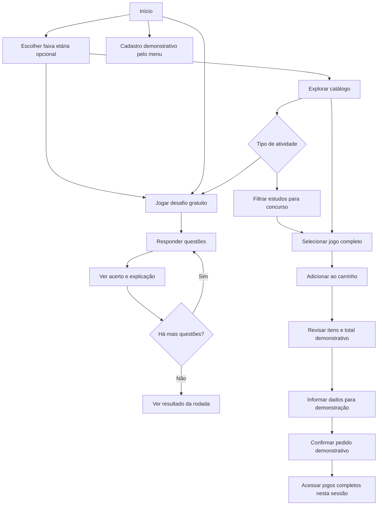

# Fluxo do usuário

O Projeto Gabarito permite explorar e jogar sem criar uma conta. A faixa etária é opcional e pode ser escolhida para filtrar atividades adequadas.

## Limites desta versão

- Não há login, conta de usuário nem verificação de identidade.
- O cadastro pode ser aberto pelo menu ou durante a finalização; os dados ficam somente na memória da sessão atual do navegador.
- A forma de pagamento é uma seleção demonstrativa: nenhuma cobrança é feita.
- O carrinho e o tema são armazenados localmente no navegador; não há envio para API ou banco de dados.
